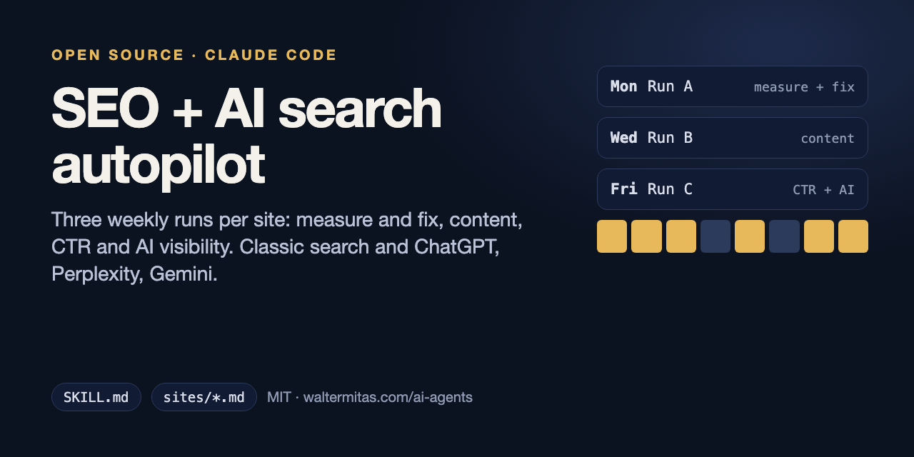

<p align="center"></p>

# Claude SEO autopilot

**A Claude Code skill that runs SEO and AI search optimisation on your sites, three times a week, without you.** It crawls, runs Lighthouse, reads Google Search Console, fixes what is safe, pushes, logs what it changed and measures the result 28 days later. It covers classic search and AI search: ChatGPT, Claude, Perplexity, Gemini and Google AI Overviews.

  

## Why this exists

SEO work is repetitive and easy to skip: check the numbers, fix the titles, refresh a page, add links, see what worked. A person does it for two weeks and stops. An AI agent on a schedule does not stop, provided it has a method and guardrails. This repo is that method, running unattended on my own sites since October 2026.

## How it works

One shared method in [`skills/seo/SKILL.md`](skills/seo/SKILL.md). One small config file per site in `skills/seo/sites/`. Each site gets three scheduled runs a week, each with its own focus, so no single run tries to do everything.

| Run | Day | Focus |
| --- | --- | --- |
| **A** | Monday | **Measure and fix.** Pick the killer page, check access and speed, fix every technical error, pull the long-question list. |
| **B** | Wednesday | **Content.** Answer-first question blocks on pages that already rank, refreshes with a keyword coverage pass, at most one new article. |
| **C** | Friday | **CTR, links and AI.** Rewrite titles for low-CTR pages, add striking-distance links, judge what worked after 28 days, send the weekly summary. |

On the first run A of each month it also does keyword research and the AI citation probe.

## What it covers

- **Technical SEO:** crawl errors, broken links, links to redirects, alt text, hreflang and canonicals, title and description length, Lighthouse, indexing reasons. Fixed directly, behind a build gate that fails on hard errors.
- **Content refreshes:** answer-first rewrites, FAQ blocks, internal links, primary-source citations, a keyword coverage pass per page, with caps per week so nothing is churned.
- **AI search (GEO and AEO):** AI crawler access, answer-first structure, entity signals, citable facts, AI referral traffic in GA4 and a monthly citation probe across assistants. No `llms.txt`, no schema tricks: [the reasoning is in the skill](skills/seo/SKILL.md#ai-search-geo-and-aeo-appear-in-chatgpt-claude-perplexity-gemini-and-ai-overviews).
- **Long-question filter:** a Search Console regex for 8-or-more-word queries, with the unattended URL form that actually applies it (the `~` before the regex is essential). Turns the questions people type into answer blocks on pages that already rank.
- **Conversion-first rules:** a killer page per site, a SERP intent check before rewriting, and an honest win-or-miss verdict that looks at search and conversions together.

## Quick start

```bash
git clone https://github.com/waltermitas/claude-seo-autopilot.git
cp -r claude-seo-autopilot/skills/seo ~/.claude/skills/seo
cp ~/.claude/skills/seo/sites/example.md ~/.claude/skills/seo/sites/mysite.md
```

1. Edit `sites/mysite.md`: repo path, Search Console property, markets, content rules, the NEVER list and the deploy rule.
2. Add the three SEO scripts to your site repo (crawl, Lighthouse, on-page lint chained after `build`). The skill's bootstrap section describes each.
3. Create a scheduled task per site, Monday, Wednesday and Friday. The prompt is five lines; see [`examples/scheduled-tasks.md`](examples/scheduled-tasks.md).
4. Read `SEO - Log.md` after the first run. Every change records its before, after and reason.

You need: Claude Code, a site in a repository with a build step, Search Console access in a signed-in browser, and optionally GA4. It never signs in, solves CAPTCHAs or creates accounts.

## Guardrails that make unattended runs safe

- **Fix directly, but only inside the site file's rules.** URLs and slugs never change (except adding a 301), the lint gate is never weakened, and nothing is force-pushed.
- **Caps per week:** 5 content passes, 3 CTR rewrites, 5 new internal links, 1 new article. Shared across the three runs.
- **One pass per page.** A page with a full pass in the last 28 days is measured, not touched again.
- **Quality gate:** every factual claim is checked against a primary source, and anything unverifiable is cut. No invented experiences, numbers or reviews.
- **Honest measurement:** a ranking gain with no extra conversions is logged as a miss.
- **A run record per run**, including failed and no-op runs, so a missing record looks like a missed run.

## FAQ

**Can Claude Code do SEO on a schedule?**
Yes. Create a scheduled task per site whose prompt points at the skill and the site file. The skill handles the run stamp, the cap bookkeeping, the log and the report.

**How do I get my site into ChatGPT, Perplexity and Google AI Overviews?**
Allow the AI crawlers in `robots.txt`, serve full content in the raw HTML, and write answer-first pages: a heading phrased as the question, then a direct 40-60 word answer, then the detail. The skill checks access every run and measures AI referral traffic and citations.

**Does adding schema or an `llms.txt` file get me cited by AI?**
Not as a shortcut. The skill adds schema only where a page qualifies for a rich result, and does not create `llms.txt`, because search engines say special AI files are not needed.

**Which Search Console regex finds long questions?**
`^(?:\S+\s+){7,}\S+$` matches queries of 8 or more words. Lower the 7 to 4 or 3 for smaller sites. The unattended URL needs `query_operator=REGEX&query=~<regex>`.

**Is it safe to let an AI agent push SEO changes to my site?**
Only with guardrails: a build gate that fails on hard errors, a NEVER list per site, weekly caps, one commit per run and an easy revert. Start with the deploy rule set to "open a pull request" if you want review.

## Related projects

- [claude-agent-fleet-monitor](https://github.com/waltermitas/claude-agent-fleet-monitor): a dead-man switch for scheduled AI agents like these.
- [watch-hunter-skill](https://github.com/waltermitas/watch-hunter-skill): scheduled AI agents that hunt underpriced watches.
- [watch-script-skill](https://github.com/waltermitas/watch-script-skill): a YouTube script and blog writer for watch videos.

The whole fleet, and what each AI agent got wrong, is at [waltermitas.com/ai-agents](https://waltermitas.com/ai-agents/).

## Credits

The long-question filter technique was popularised by AskOkara.

## Licence

MIT
